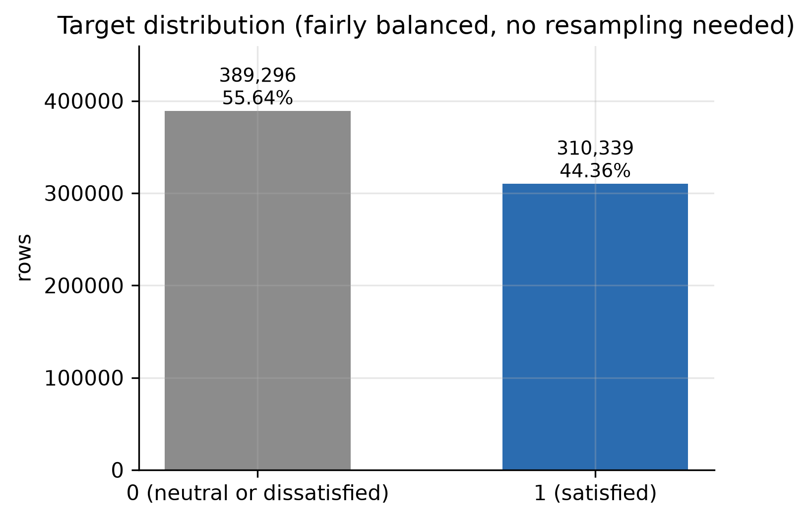
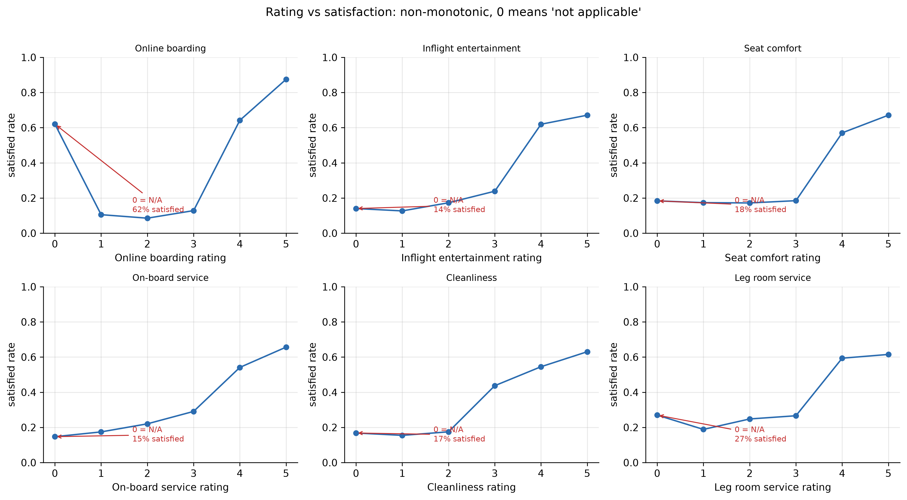
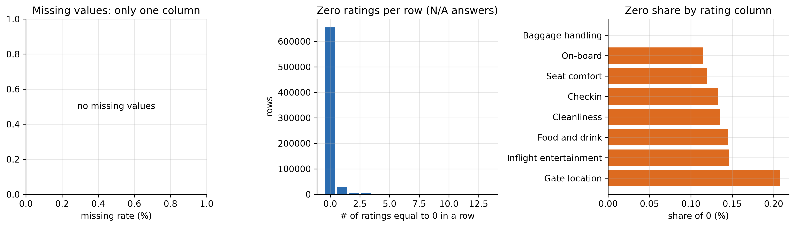
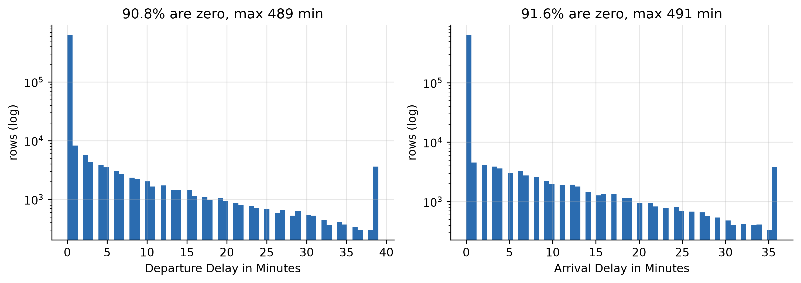
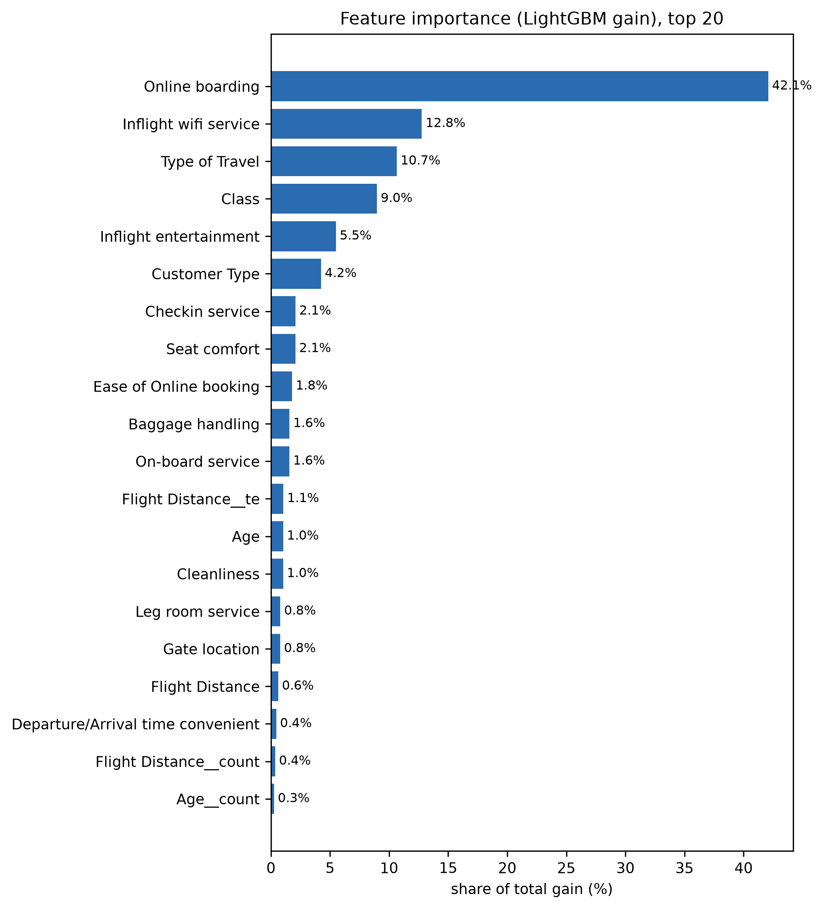

# P1 数据与特征报告 · 航空乘客满意度预测（Kaggle S6E10）

> **本人负责部分（P1）**：数据获取与校验、EDA、划分方案论证、特征设计（base/A/B/C/T）与消融、泄漏排查、事后特征实验。
> 模型训练与调参见 P2 报告，评估协议/稳定性/可解释性/误差分析见 P3 报告；共用数字口径与 `plan.md` 一致。
> **可复现约定**：本文每个数字都能在 `reports/exp_log.csv` 按 `run_id` 查到；数据结构可由 `make data` 重建。

---

## 1. 数据从哪里来

### 1.1 数据集

| 项 | 值 |
|---|---|
| 比赛 | Kaggle Playground Series S6E10 — Predicting Airline Satisfaction |
| 任务 | 二分类，预测 `satisfaction` 概率 |
| 指标 | ROC AUC（提交概率，禁止阈值化） |
| 原始性质 | 合成数据，源自真实调查集 *Airline Passenger Satisfaction*（129,880 行） |

官方比赛数据下载需要登录态。本仓库使用 Kaggle 公开镜像
`vijaikm/s6e10-downcasted-parquet-5fold`（CC BY 4.0）转回 CSV，
并用 `base + LightGBM` 复现出 OOF AUC **0.958829**，与独立公开分析报告的 0.95883
一致到小数点后 5 位，说明行序、类型、缺失处理与官方数据等价。

> 注意：`data/raw/CHECKSUMS.txt` 校验的是**本仓库入库的这份文件**，不是 Kaggle 官方原文件。
> 它能发现“中途被替换”，但不能证明与官网字节一致。若课程要求官方数据，
> 用组内账号重新下载后跑 `make data && make train`，应仍为 0.958829。

### 1.2 规模与字段

| 文件 | 行 × 列 | 说明 |
|---|---|---|
| `data/raw/train.csv` | 699,635 × 23 | 含目标列 `satisfaction` |
| `data/raw/test.csv` | 299,844 × 22 | 无目标列 |
| `data/raw/sample_submission.csv` | 299,844 × 2 | 基准率 0.4436 |

字段分四组：

- **标识/目标**：`id`（建模前删除）、`satisfaction`（0/1，正例 44.36%）。
- **类别列（4 个）**：Gender、Customer Type、Type of Travel、Class。基数都只有 2–3。
- **序数评分（13 个，0–5）**：WiFi、出发/到达时间便利、在线订票、登机口、餐饮、
  Online boarding、座椅舒适、娱乐、机上服务、腿部空间、行李、值机、清洁。
- **数值列（4 个）**：Age、Flight Distance、Departure Delay、Arrival Delay。

### 1.3 六项数据检查

| 检查项 | 结论 | 处置 |
|---|---|---|
| 行数/列数 | train 699,635 × 23，test 299,844 × 22 | 规模足够支撑三份报告 |
| 目标分布 | 310,339 / 699,635 = **44.36%** | 类别均衡，不做重采样；主指标 AUC，不看 accuracy |
| 缺失 | 仅 `Arrival Delay in Minutes`：train 292 / test 130（0.04%） | `arr_delay_missing` 标记 + 用出发延误**行内**填补 |
| 重复 | 忽略 `id` 后 0 行 | 清洗仍保留兜底（按除 id 外的列判重） |
| 异常 | 延误长尾，约 90% 为 0；`id` 唯一率 100% | `log1p` + `is_delayed`；id 建模前删除 |
| 时间/分组 | 无时间列、无实体列；train/test 无漂移 | StratifiedKFold 主线；距离分箱做 GroupKFold 鲁棒性检验 |

---

## 2. EDA：三条必须写进报告的领域事实

### 2.1 0 分表示“不适用”，不是“最差”

这是全项目最重要的一条数据事实。13 个评分列的 0 分不是序数意义上的“比 1 更差”，
而是“该服务不适用/未体验”。直接证据：

- WiFi 评 0 的满意率约 **89%**，评 1 只有 **39%**；
- Online boarding 评 0 的满意率约 **62%**，评 1 只有约 **10.5%**；
- 其余评分列的 0 分也普遍不低于 1 分，呈 U 型而非单调。

**影响**：任何“评分求和/求均值”若不先处理 0，都会被污染——0 会把“没体验”拉成“极差”。
这就是特征组 A（0→NaN + `is_zero` 标记）存在的理由，也是 B 组“隐含 A”的原因。

### 2.2 信号以阈值型为主

满意度随评分不是平滑线性上升，而是在 3→4、2→3 处出现跳变（座椅/娱乐/餐食、值机/清洁）。
这解释了为什么树模型在原始评分上已经很强，而线性模型需要显式的分段/交互特征。

### 2.3 主导特征是舱位与在线登机

Class=Business 的满意率约 72.5%，Personal Travel 只有约 9.7%；
Online boarding 是单列重要性最高的特征（gain 占比 42.1%）。延误信号相对弱：
无延误约 45% 满意，延误 >15 分钟约 31%。

---

## 3. 划分方案：为什么冻结 StratifiedKFold

数据没有时间列，也没有机场/航段等实体列，只有 `Flight Distance` 可以作为“航线”的代理。
因此比较三种方案：

| 策略 | 各折正例率 std | 5 折 CV AUC | 说明 |
|---|---:|---:|---|
| KFold | 0.001462 | 0.95877 | 折间正例率有波动 |
| **StratifiedKFold（主线）** | **0.000003** | **0.958829** | 正例率几乎完全一致，CV 最稳 |
| GroupKFold（Flight Distance 50 分箱） | 0.012103 | 0.957784 | 按距离段分组，模拟“新航线” |

GroupKFold 只掉 0.001，说明模型不是靠记住具体航线，而是学到了可迁移的服务信号。
这是比“分数高”更有说服力的鲁棒性证据。

**冻结**：`splits/fold_v1.json` 保存了 699,635 行的 `fold_of_row`（stratified, 5 折, seed 42），
并记录每折行数、正例率、创建日期。所有实验必须 `load_folds()` 取折，禁止自己 `train_test_split`。
冻结后只读；`make split` 现在会拒绝覆盖，除非显式 `--force` 并自动备份。

---

## 4. 特征设计：base / A / B / C / T

特征以可开关模块组织，`--groups base,A,B,C,T` 任意组合。设计原则是
**每一组只回答一个问题，且能单独消融**。

| 组 | 内容 | 用标签？ | 设计理由 |
|---|---|---|---|
| **base** | 原始 21 特征 + `arr_delay_missing` | 否 | 对照组；不加工，看模型能吃多少 |
| **A** | 13 个 `__is_zero` + 原评分 0→NaN | 否 | 把“不适用”从“最差”里拆出来 |
| **B** | `n_zeros`、`n_fives`、评分 mean/min/std、Travel×Class、总延误、`arr-dep`、`is_delayed`、`delay_log`、距离分箱（共 11 列） | 否 | 聚合/交互；B 隐含 A，否则均值没有业务含义 |
| **C** | Flight Distance / Age 频次编码 | 否 | 只用特征、不用标签；train+test 全量统计，转导安全 |
| **T** | Flight Distance 平滑目标编码（m=20） | **是** | 全项目唯一有泄漏风险的变换，单独成组、单独消融 |

列数账本（`docs/feature-dictionary.md` 自动生成，覆盖 49 列）：

| 组 | base | A | B | C | T | 合计 |
|---|---:|---:|---:|---:|---:|---:|
| 列数 | 22 | 13 | 11 | 2 | 1 | **49** |

> 目标编码只在**训练折内** `fit`，验证折与 test 只 `transform`。
> 实现见 `src/features/encode.py`，调用点见 `src/models/train.py` 的 5 折循环。

---

## 5. 消融：同一组特征，两个模型族，价值差两个数量级

5 折 OOF AUC（`splits/fold_v1.json`，seed 42）：

| 特征组 | 维数 | LightGBM | Δ | 逻辑回归 | Δ |
|---|---:|---:|---:|---:|---:|
| base | 22 | 0.958829 | — | 0.921550 | — |
| +A | 35 | 0.958800 | −0.000029 | 0.940807 | **+0.019257** |
| +B | 46 | 0.958650 | −0.000179 | 0.943866 | **+0.022316** |
| +C | 24 | 0.959413 | +0.000584 | 0.921643 | +0.000093 |
| +C+T | 25 | **0.960191** | **+0.001362** | 0.923300 | +0.001750 |
| A+B+C+T | 49 | 0.960048 | +0.001219 | **0.945162** | **+0.023612** |

对应 `run_id`：`P1_feat_lgbm_base_1026`、`P1_feat_lgbm_A_1026_abl`、`P1_feat_lgbm_C_1026_abl`、
`P1_feat_lgbm_CT_1026_abl`；B 与 ABCT 因分箱语义修正后重跑，对应
`P1_feat_lgbm_B_1031_s42_abl2`、`P1_feat_lgbm_ABCT_1031_s42_abl2`；
LR 行为 `P1_feat_lr_*`（B/ABCT 同样以 `_abl2` 结尾）。

> 分箱修正说明：原实现每个子集各自 `qcut`，B 组 `dist_bin` 的边界会随调用方式漂移；
> 现在改为在全量 train 上 fit 10 分位边界、所有子集用固定边界。默认 `base+C+T` 不含 B，
> 主分数不变；B/ABCT 的数值因此有 1e-5 量级变化，结论不变。

### 5.1 怎么读这张表

1. **对树模型，A/B 是零增益甚至负增益**。A 把 `(0, 原值)` 换成 `(is_zero, NaN)`，
   对树几乎是信息等价的——树本来就能在 0 处单独切一刀；B 的聚合量都是原始列的确定性函数，
   树可以通过多次分裂逼近。多出来的 24 列没有新增信息，反而稀释了 `colsample_bytree=0.8` 的采样。
2. **对线性模型，A/B 是 +0.019 ~ +0.022 的大增量**。线性模型把 0 当成“比 1 更低”，
   与真实语义相反；A 的 `is_zero` 标记恢复了非单调性，B 的交互/聚合补上了它无法自动表达的结构。
3. **C+T 是树模型唯一稳定的增量（+0.0014）**。频次编码提供“这条航线有多常见”，
   目标编码提供“这条航线的平滑满意率”，都是树自己不容易从单列距离学到的全局统计量。
4. **全加不一定最好**：`A+B+C+T`（0.960048）低于 `C+T`（0.960191）。
   这说明特征工程的价值不在“造了多少列”，而在“模型能不能用上”。

> 一句话：**特征工程的价值不在特征本身，而在模型能不能表达它。**

### 5.2 特征重要性（LightGBM gain，base+C+T）

| 排名 | 特征 | gain 占比 |
|---:|---|---:|
| 1 | Online boarding | 42.08% |
| 2 | Inflight wifi service | 12.77% |
| 3 | Type of Travel | 10.65% |
| 4 | Class | 8.97% |
| 5 | Inflight entertainment | 5.50% |
| 6 | Customer Type | 4.24% |

注意：重要性高 ≠ 去掉会掉分。`Flight Distance__te` 的 gain 占比只有 1.06%，
但消融显示 T 组带来 +0.0008——两件事必须分开写。

---

## 6. 泄漏排查与事后特征实验

| 风险 | 结论 | 处理 |
|---|---|---|
| ID 类泄漏 | 低 | `id` 建模前删除 |
| 时间泄漏 | 不存在 | 无时间列 |
| 跨折重复 | 不存在 | 忽略 id 后 0 重复；train/test 无重叠 |
| 目标编码泄漏 | **高** | 只训练折 fit；T 单独成组、单独消融 |
| 事后特征 | **高** | `Arrival Delay` 飞行后才知道 |

### 6.1 目标编码写错会怎样

`docs/verify.md` 记录了一次破坏性实验：把 `fit(Xtr, ytr)` 改成 `fit(X, y)`（全量），
OOF AUC 从 0.960191 变成 0.960640，**只虚高 0.00045**。

原因：Flight Distance 有 3,474 个取值、每条约 200 行，平滑参数 m=20 把单行的自身标签稀释了。
**结论：这类泄漏在本数据上“小到看不出来”，靠分数发现不了，只能靠代码审查。**
所以 T 组必须单独成组、单独消融，验收时必须看 `fit` 的入参是不是 `Xtr`。

### 6.2 剔除事后特征

`Arrival Delay` 与起飞延误 r≈0.84、87% 的行完全相等。剔除 `Arrival Delay` + `arr_delay_missing`
后重跑 `base+C+T`：

| 实验 | OOF AUC | Δ |
|---|---:|---:|
| `C+T`（含到达延误） | 0.960191 | — |
| `C+T` 剔除到达延误（`run_id=P1_feat_lgbm_CT-drop_1026_noarr`） | 0.960157 | **−0.000034** |

几乎无损失。**结论：最终模型可以只使用飞行前即可获得的信息，业务上可部署。**

---

## 7. 结论、局限与下一步

### 7.1 结论

1. 数据 95% 的信号已经在原始特征里；树模型不需要人工聚合。
2. 特征工程的收益高度依赖模型族：A/B 对 LR 是 +0.02，对 LGBM 是 0 或负。
3. 树模型唯一稳定的增量是 C+T（+0.0014），且 T 的有效性依赖折内拟合纪律。
4. 按距离段分组只掉 0.001，说明信号可迁移；剔除到达延误只掉 0.00003，说明可部署。
5. 全加（49 列）不如精选（25 列），特征在“精”不在“多”。

### 7.2 局限

- 消融表是**单 seed、固定划分**的结果；`+0.0014` 与折间 std（0.0006）同量级，
  不能直接称为“显著提升”。P3 的 3 seeds × 5 folds 稳定性实验用于补上这一点。
- 数据是公开镜像，不是官方原文件；虽然 base 分数逐位复现，但严格性弱于官方下载。
- 没有官方 Public LB 提交记录；所有“公开领先 0.9642”的对照来自公开分析，不是本人提交。

### 7.3 下一步（已交接给 P2/P3）

- P2：主力模型 `base+C+T`、5 折平均提交、最终 OOF 与 `run_id` 登记。
- P3：评估协议、校准、3 seeds 稳定性、SHAP、badcase、误差分析。
- 全组：任何“变好”先排除 seed 波动；改动必须过 `make verify`。
