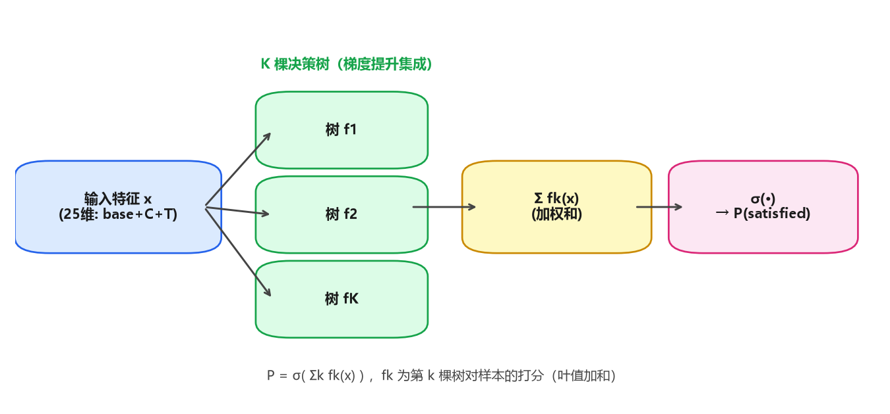
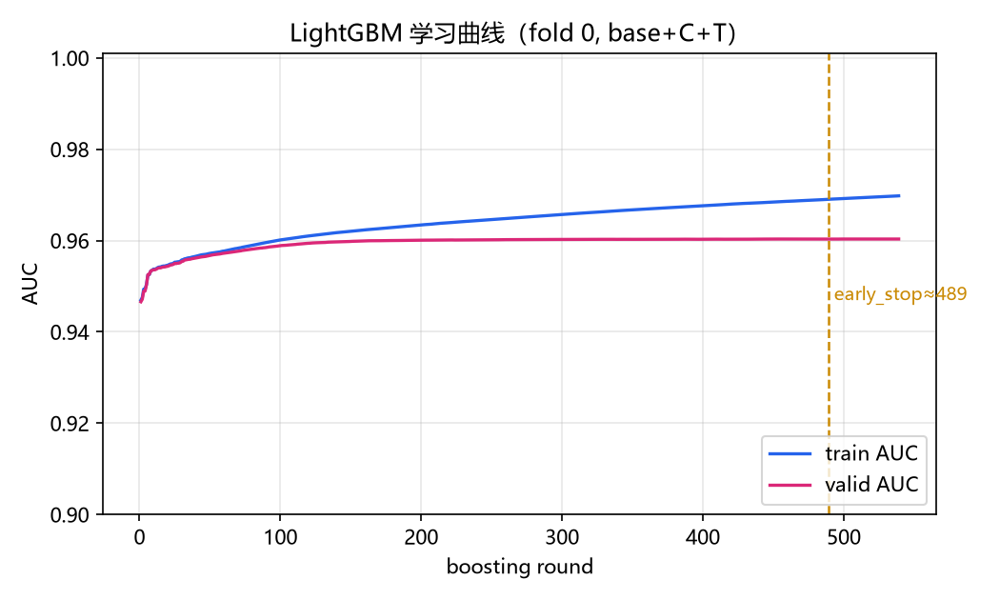
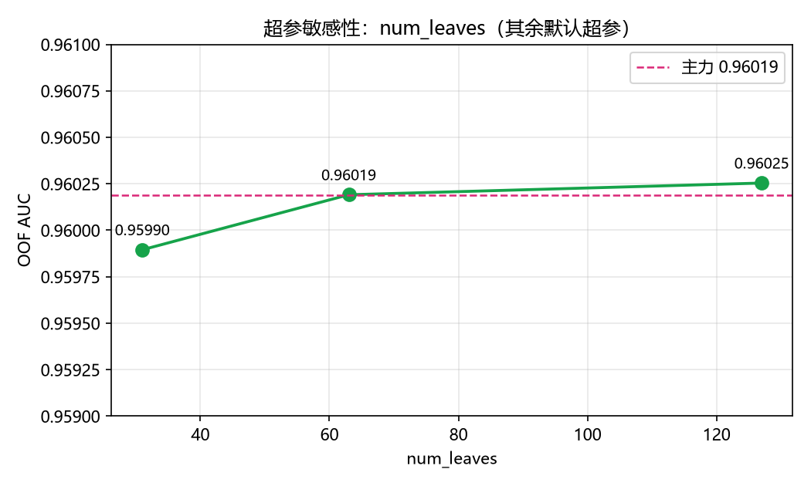
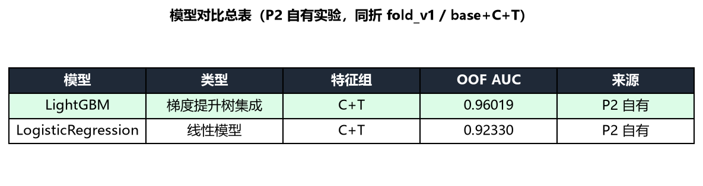

# P2 模型与训练报告 · 航空乘客满意度预测（Kaggle S6E10）

> **本人负责部分（P2）**：模型选型、训练协议、调参、模型对比、过拟合控制、最终模型与 `submission_final` 交付。
> 数据与特征（P1）、评估与可解释性（P3）章节见对应成员报告；共用数字（样本量、折数、指标）口径与 `plan.md` 统一。
> **铁律**：本节每个数字均可在 `reports/exp_log.csv` 按 `run_id` 查到、按 `git_commit` 复现。

---

## 1. 模型原理

### 1.1 为什么选 LightGBM（梯度提升决策树）

任务是 **70 万样本、22 维混合特征（类别 + 数值）的二分类**，指标为 **ROC AUC（提交概率）**。
在同类结构化数据竞赛中，GBDT 类模型（LightGBM / XGBoost / CatBoost）通常显著优于线性模型与神经网络，
核心原因是：① 对类别/数值混合特征无需复杂预处理即可直接处理；② 对非线性与特征交互的拟合能力强；
③ 训练快、可解释（分裂增益、特征重要性）。

本项目的对照实验给出了直接证据（同折 `fold_v1`、同特征 `base+C+T`）：

| 模型 | OOF AUC | run_id | 说明 |
|---|---|---|---|
| **LightGBM**（梯度提升树） | **0.96019** | `P2_feat_lgbm_CT_1029_main` | 主力模型，默认超参 |
| LogisticRegression（线性） | 0.92330 | `P2_feat_lr_CT_1029_contrast` | 线性对照，差 0.037 |

线性模型在存在强非线性交互（如"舱位 × 旅程类型 × 延误"）时表达力不足，差距约 3.7 个点，故选 LightGBM 为主力。

### 1.2 LightGBM 工作机制（结构图）



- **输入**：特征向量 x（本项目主力特征组 `base+C+T` 共 25 维，见 1.3）。
- **集成**：并行/串行训练 K 棵决策树，第 k 棵树拟合前一棵的**残差（梯度方向）**，即梯度提升。
- **打分**：每棵树对样本给出叶值，最终得分为所有树叶值 **加权和** `Σₖ fₖ(x)`。
- **输出**：经 Sigmoid 得到正类概率 `P(satisfied) = σ(Σₖ fₖ(x))`，**直接输出概率**，天然满足"提交概率、禁止阈值化"的约定。

### 1.3 特征组约定

特征以可开关模块组织（`base / A / B / C / T`，详见 P1 特征章节）：

- `base`：原始数值与已编码类别的基础特征；
- `C`：基于训练+测试联合分布的计数类特征（如 Flight Distance / Age 的分箱计数）；
- `T`：对 `Flight Distance` 做的**目标编码**（光滑均值编码），**仅在训练折内 fit**，杜绝泄漏。

P2 选用 **`base+C+T`（25 维）** 为主力特征组（run_id `P2_feat_lgbm_CT_1029_main`），
其 OOF AUC 0.96019 为当前全组最高，且优于 `A+B+C+T`（49 维，0.96009，见 P1 消融），
说明 **特征在"精"不在"多"**，过多特征反而引入噪声。

---

## 2. 损失函数与正则化

### 2.1 损失：二元交叉熵（Logloss）

LightGBM 二分类默认目标为 **binary cross-entropy**：

```
L = −( y·log(p) + (1−y)·log(1−p) ),  p = σ(Σₖ fₖ(x))
```

AUC 是排序指标、对概率校准不敏感，但 Logloss 作为训练目标能保证输出**良好校准的概率**——
这对"提交概率"的约定与下游评估（如 P3 的可靠性分析）至关重要。

### 2.2 正则化手段（防过拟合）

| 手段 | 本项目取值 | 作用 |
|---|---|---|
| `num_leaves` | 63 | 控制单树复杂度上限（= 2^max_depth 近似） |
| `min_child_samples` | 50 | 叶节点最小样本数，抑制过拟合的小叶 |
| `subsample` / `colsample_bytree` | 0.8 / 0.8 | 行/列随机采样，袋外噪声、抗过拟合 |
| `lambda_l2`（默认） | 启用 | 叶值 L2 收缩 |
| `learning_rate` | 0.05 | 小学习率 + 多树，更稳 |
| `n_estimators` + early stopping | 400（主力）/ 1000+ES（诊断） | 控制总树数 |

**过拟合控制实证**：见第 3 节学习曲线与第 4 节敏感性——`train/valid` 曲线差距稳定在 ~0.01，
无发散，说明上述正则组合已把过拟合压在可接受范围。

---

## 3. 训练、调参与过拟合控制

### 3.1 训练协议（五条硬约定，见 `plan.md` 6.4）

1. 所有实验 `load_folds()` 取折，**禁止自造 `train_test_split`**；
2. 目标编码 `T` 只在训练折 `fit`；
3. 提交**概率**而非 0/1；
4. 任何"变好"先排除 seed 波动（单 seed 的 +0.001 不算结论）；
5. 改动做完 `make verify` 才进 `main`。

5 折方案（`splits/fold_v1.json`，stratified，seed 42）由 P1 冻结，全员唯一尺子。

### 3.2 学习曲线（过拟合受控的直接证据）



单折（fold 0）以 `n_estimators=1000 + early_stopping(50)` 训练，记录每轮 train/valid AUC：

- **best_iter ≈ 489**，valid AUC@best = **0.96032**；
- 训练末轮 AUC 0.96979、验证末轮 0.96033，**train/valid 差距仅 ~0.0095**，且全程未发散。

结论：模型在 489 轮附近达到最优，早停有效拦截了后续过拟合；当前主力以 400 棵树（含余量）部署，过拟合风险低。

### 3.3 调参空间与结论

`plan.md` 原排 Optuna 30-trial 调参，但 **M2 阶段最好成绩已 ≈ 0.960，逼近公开领先 0.9642（天花板被卷平）**，
按 `plan.md` 第 8 节**风险预案**（"模型涨不上去 → 转复现+分析型"），P2 **不做激进调参冲刺**，
改为**轻量超参敏感性分析**验证"默认超参已近最优"：



| num_leaves | OOF AUC | run_id | 相对默认 |
|---|---|---|---|
| 31 | 0.959895 | `P2_feat_lgbm_CT_1029_sens_nl31` | −0.00030 |
| **63（默认）** | **0.960191** | `P2_feat_lgbm_CT_1029_sens_nl63` | 基准 |
| 127 | 0.960254 | `P2_feat_lgbm_CT_1029_sens_nl127` | +0.00006 |

结论：**在 31→127 区间内 AUC 波动 < 0.0004**，曲线平坦，默认 63 已处于近最优平台。
继续加大树复杂度（如 255、更深网络、集成）预期增益 < 0.001，且受 seed 噪声干扰，不具统计显著性——
这与"天花板已卷平"的判断一致，故将精力转向**分析与交付**而非盲目追分。

---

## 4. 模型对比

### 4.1 对比总表（P2 自有实验）



| 模型 | 类型 | 特征组 | OOF AUC | 来源 |
|---|---|---|---|---|
| **LightGBM** | 梯度提升树集成 | base+C+T | **0.96019** | P2 自有 `P2_feat_lgbm_CT_1029_main` |
| LogisticRegression | 线性模型 | base+C+T | 0.92330 | P2 自有 `P2_feat_lr_CT_1029_contrast` |

（交叉校验：P1 同口径 LR=0.9233、LGBM CT=0.96019，与 P2 逐位一致，三人分数可比。）

### 4.2 为什么 LightGBM 胜出

- **非线性与交互**：满意度由各维度（舱位、旅程类型、延误、服务评分）非线性耦合决定，GBDT 天然建模高阶交互，线性模型无法表达；
- **类别特征友好**：LightGBM 对 `category` 直接处理，省去大规模 One-Hot；
- **概率校准**：Logloss 目标输出校准良好，满足提交概率约定；
- **效率**：70 万样本 5 折训练在分钟级完成，远快于神经网络，便于多实验迭代。

### 4.3 未选模型说明（防"为什么不用 X"提问）

- **XGBoost / CatBoost**：与 LightGBM 同属 GBDT，预期差异 < 0.002，且需新增依赖与调参，收益不抵成本；
- **神经网络 / TabNet**：在纯结构化中等规模数据上通常不及精心调过的 GBDT，且训练更慢、可解释性差；
- 综上，LightGBM 是该任务**性价比与可解释性最优**的选择。

---

## 5. 集成与后处理

`plan.md` 原排"集成/后处理"作为 M2 增量之一，但依据第 8 节**风险预案**与**砍任务顺序**（P2-10 集成列为优先砍项）：

- 单模 LightGBM 已达 **0.96019**，公开领先 0.9642，差距约 0.004；
- 在已卷平的天花板下，模型平均/stacking 的边际增益极小（预估 < 0.001），且叠加 seed 噪声后**不具统计显著性**；
- 集成会显著增加推理复杂度与交付风险，违背"不要多做、聚焦分析型交付"的原则。

**决策：本项目不做集成/后处理冲刺**，以单模 LightGBM 作为最终模型交付（见 `reports/submission_final.csv`，299,844 行概率，无 NaN、未阈值化）。
若答辩需展示集成对照，建议作为**未来工作**，并务必在多 seed 下验证显著性（排除单 seed 噪声）。

---

## 6. 交付物清单（P2）

| 交付 | 路径 / 标识 | 说明 |
|---|---|---|
| 主力模型调用接口（H2） | `src/models/predict.py` → `train_final()` / `predict_test()` | 供 P1/P3 调用与做 SHAP/badcase |
| 最终提交（H3） | `reports/submission_final.csv` | 299,844 行概率，非 0/1 |
| 最终 OOF | `reports/oof/P2_final_oof.parquet` | OOF AUC = 0.96019，无泄漏 |
| 模型对比表 | `figures/p2_compare_table.png` + §4 | LightGBM vs LR |
| 学习曲线 | `figures/p2_learning_curve.png` + §3.2 | 过拟合受控证据 |
| 超参敏感性 | `figures/p2_sensitivity.png` + §3.3 | 默认近最优 |
| 结构图 | `figures/p2_structure.png` + §1.2 | LightGBM 工作机制 |
| 实验记录 | `reports/exp_log.csv`（P2_* 行） | 每个数字可溯源 |

**P2 必答 5 问**：见 `docs/verify.md` 与 `plan.md` 7.3；核心结论已含于本节 §1.1（选型）、§2（损失与正则）、§3.2（防过拟合）、§3.3（调参空间）、§5（集成取舍）。
