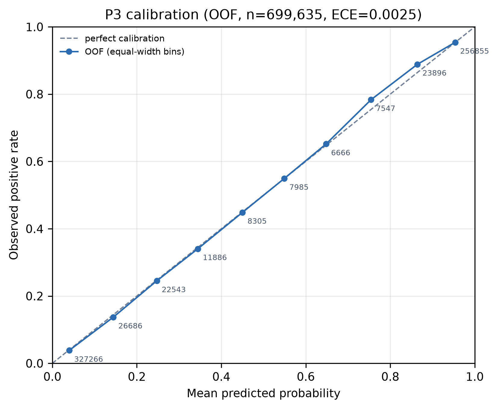
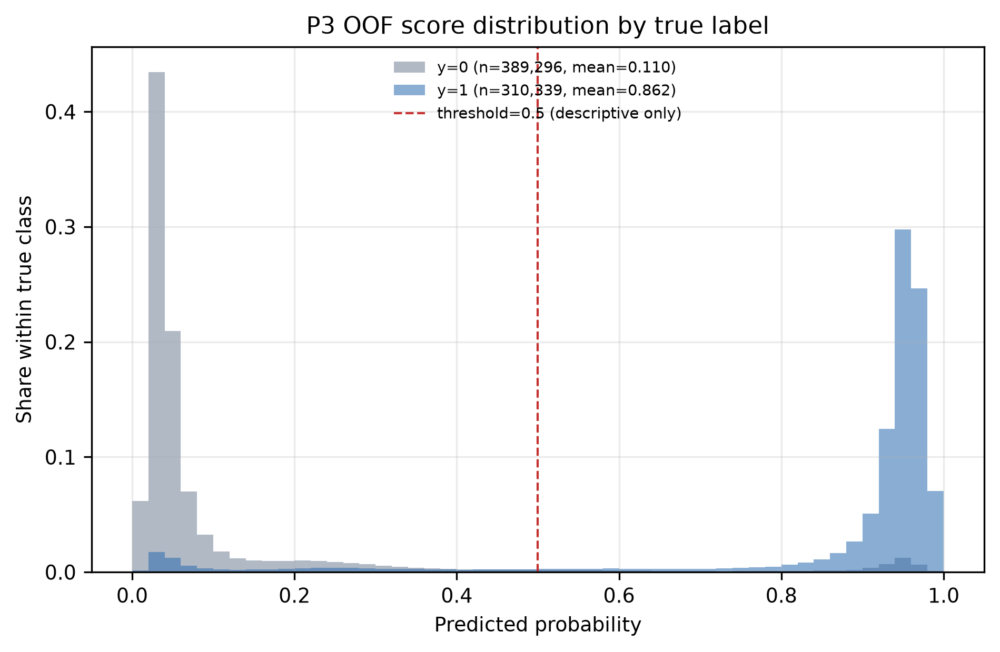
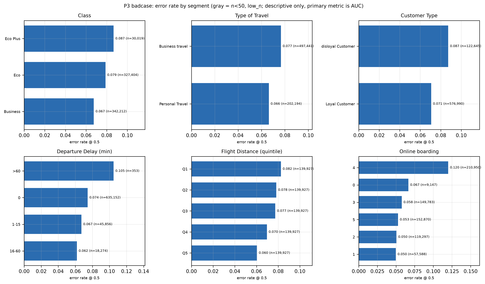
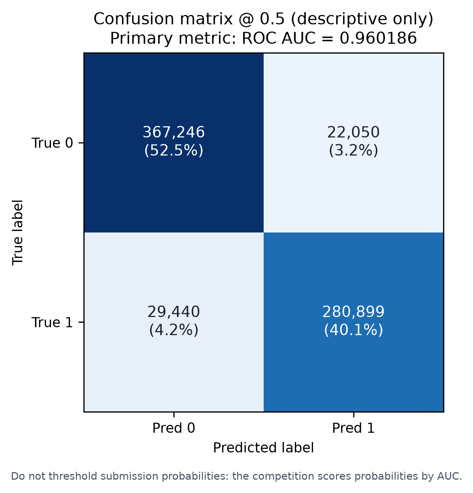
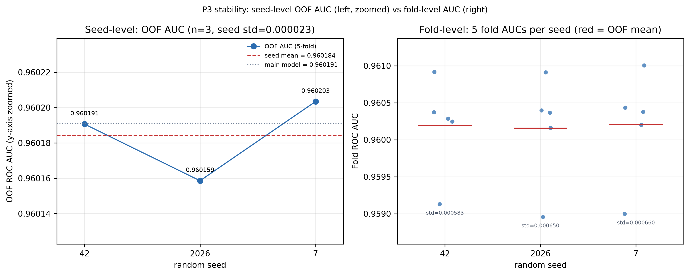
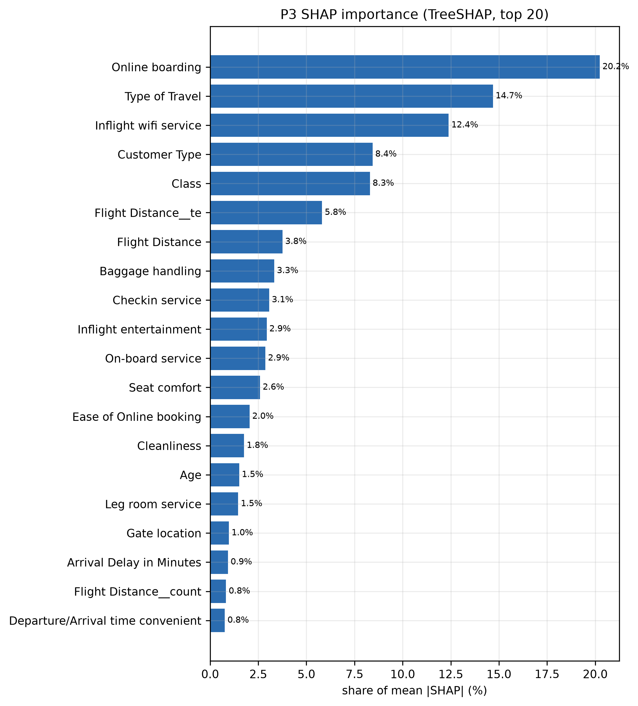
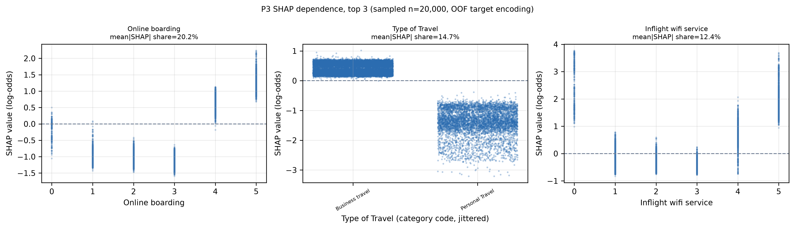

# P3 评估与可解释性报告 · 航空乘客满意度预测（Kaggle S6E10）

> **本人负责部分（P3）**：评估协议、校准分析、分群误差、3 seeds 稳定性、SHAP 可解释性、badcase 归纳、复现说明。
> 数据与特征见 P1 报告，模型与训练见 P2 报告；共用数字口径与 `plan.md` 一致。
> **主指标是 ROC AUC**；accuracy / precision / recall / F1 / 混淆矩阵都依赖 0.5 阈值，只用于描述，不能用于选模型。提交的是概率，禁止阈值化。

---

## 1. 评估协议

| 项 | 约定 |
|---|---|
| 数据 | 冻结划分 `splits/fold_v1.json`（stratified, 5 折, seed 42） |
| 预测 | 每折在 4 折上训练、留出折预测；5 折拼成 699,635 行 OOF |
| 主指标 | ROC AUC（全局 + 分群 + bootstrap 95% CI） |
| 辅助指标 | LogLoss、Brier、ECE（校准）、阈值 0.5 下的混淆矩阵 |
| OOF 来源 | `reports/oof/P2_final_oof.parquet`（与 `submission_final.csv` 同一协议、同一模型） |
| 稳定性 | 3 seeds（42 / 2026 / 7）× 固定 5 折；只换 `random_state`，其余完全不变 |
| 可解释性 | LightGBM `pred_contrib=True` 的 TreeSHAP；T 组用 **OOF 目标编码**，避免自泄漏 |

> 交接说明里“最终预测已锁定，P3 无需重训即可评估”成立：评估直接读 P2 的 OOF，
> 不重新训练主模型。SHAP 也不用 `train_final()`——它在全量 train 上 fit 目标编码再
> transform 同一张表，会自泄漏；P3 用逐折 OOF 编码，见第 5 节。

---

## 2. 主结果

| 指标 | 值 |
|---|---:|
| 评估样本 | 699,635 |
| 正例数 / 正例率 | 310,339 / 44.36% |
| **OOF ROC AUC** | **0.960186** |
| AUC bootstrap 95% CI | [0.959715, 0.960605]（n_boot=200, seed=42） |
| LogLoss | 0.225458 |
| Brier | 0.060432 |
| ECE（10 箱） | **0.002479** |
| 阈值 0.5 下 Accuracy | 0.9264 |
| 阈值 0.5 下 Precision | 0.9272 |
| 阈值 0.5 下 Recall | 0.9051 |
| 阈值 0.5 下 F1 | 0.9160 |
| TN / FP / FN / TP | 367,246 / 22,050 / 29,440 / 280,899 |

对应 `run_id=P2_final_lgbm_CT_1031_s42_final`。注意两个 AUC 口径不同：
**0.960191 是 5 折 AUC 的算术平均**（`exp_log.cv_mean`），**0.960186 是把 5 折 OOF 预测拼起来算的 pooled AUC**；
同一模型、同一份 OOF，不是两个模型，也不是随机舍入。

**读法**：AUC 0.9602 说明排序能力很强；LogLoss 0.225 与 ECE 0.0025 说明概率本身也校准得很好——
这对“提交概率”的任务很重要，虽然 AUC 本身对校准不敏感。




---

## 3. 概率校准

可靠性曲线按 10 个等宽箱统计：每箱平均预测 vs 实际正例率。

- ECE = **0.002479**（0.25%），整体接近对角线；
- 最大偏差落在 `[0.7, 0.8)`：平均预测 0.7545，实际正例率 0.7835，缺口 0.0290（n=7,547）；
- 高分段 `[0.9, 1.0]` 与低分段都没有系统性高估/低估。

**结论**：模型输出的概率可以直接作为提交值；不需要 Platt scaling / isotonic 后处理。
如果未来做业务阈值决策，应按代价重新选阈值，而不是沿用 0.5。

---

## 4. 分群表现与误差定位

### 4.1 分群 AUC

完整表见 `reports/eval/segment_metrics.csv`（22 个群，全部 n ≥ 50）。AUC 最低的 5 个群：

| 分群 | 组 | n | 正例率 | AUC | 平均预测 |
|---|---|---:|---:|---:|---:|
| Online boarding | 2 | 119,297 | 8.54% | **0.8217** | 0.0847 |
| Type of Travel | Personal Travel | 202,194 | 9.73% | **0.8302** | 0.0977 |
| Online boarding | 1 | 57,588 | 10.53% | 0.8550 | 0.1057 |
| Online boarding | 5 | 152,870 | 87.51% | 0.8753 | 0.8750 |
| Online boarding | 3 | 149,783 | 12.84% | 0.8913 | 0.1285 |

**解释**：分群 AUC 受“组内正例率低 + 标签噪声”影响，不能直接当模型缺陷。
例如 Personal Travel 的满意率只有 9.7%，组内几乎全是负例，AUC 天然更难做高；
模型对该群的平均预测 0.0977 已经非常接近真实正例率，说明**校准是准的**，只是排序区分度有限。

### 4.2 阈值 0.5 下的错误构成

| 项 | 值 |
|---|---:|
| 错误数 / 错误率 | 51,490 / **7.36%** |
| 高置信 FP（y=0 且 pred≥0.8） | 14,497 |
| 高置信 FN（y=1 且 pred≤0.2） | 16,146 |

分群错误率（完整表见 `reports/eval/badcase_summary.md`）：

| 分群 | 组 | 错误率 | 主要错误类型 |
|---|---|---:|---|
| Class | Business | 6.75% | FP 16,485 |
| Class | Eco | 7.88% | FN 20,923 |
| Class | Eco Plus | 8.67% | FN 1,917 |
| Customer Type | Loyal | 7.07% | FN 22,373 |
| Customer Type | disloyal | 8.73% | FN 7,067 |
| Online boarding | 4 | **12.00%** | FP/FN 各约 1.26 万 |
| Online boarding | 3 | 5.76% | FN 7,183 |

**最有信息量的发现**：错误率最高的不是“评分 1–2 的差评”，而是 **Online boarding = 4 的边界样本（12.0%）**。
这批判样本的评分组合处于“满意/不满意”的决策边界，标签本身可能带有主观随机性；
它们不是数据错误，而是模型无法从现有特征中区分的噪声。Business 舱的高错误以 FP 为主（模型偏乐观），
Eco 舱以 FN 为主（模型偏悲观），说明分舱位做阈值/校准会有收益。

### 4.3 badcase 样例

`reports/eval/badcase_top50.csv` 导出 100 条（FP 50 / FN 50），按置信度排序而不是随机抽样。
高置信 FP 的平均预测 0.9925，高置信 FN 的平均预测 0.0107——这些是“模型非常确信却错了”的样本，
最值得回看原始评分组合与标签口径。




---

## 5. 稳定性：3 seeds × 5 folds

| seed | OOF AUC | fold std | Δ vs 主模型 | run_id |
|---:|---:|---:|---:|---|
| 42 | 0.960191 | 0.000583 | −0.000000 | `P3_eval_lgbm_CT_1031_s42_stab` |
| 2026 | 0.960159 | 0.000650 | −0.000032 | `P3_eval_lgbm_CT_1031_s2026_stab` |
| 7 | 0.960203 | 0.000660 | +0.000012 | `P3_eval_lgbm_CT_1031_s7_stab` |
| **seed 均值** | **0.960184** | 0.000631（平均折内） | −0.000007 | — |

- **seed 间 std = 0.000023**，极差 = 0.000045；
- **折内 std ≈ 0.00063**，比 seed 间 std 大约 27 倍。

这是本项目最重要的评估结论之一：**换 seed 的波动远小于换折的波动**。
因此：

1. 单 seed 的 +0.001 不能直接当“提升”，但 C+T 的 +0.001362 仍是 seed 极差（0.000045）的 30 倍，
   在该划分下不太可能只是 seed 噪声；
2. 折间 std 0.0006 与特征增益 0.0014 同量级，所以“显著提升”必须做配对检验/更多划分，
   不能只看均值；
3. P2 报告里“默认超参已近最优、num_leaves 31→127 波动 <0.0004”与这里的 seed 噪声一致，
   继续调参的收益低于折间不确定性。



---

## 6. 可解释性：SHAP

用 LightGBM 的 `pred_contrib=True` 在 20,000 行采样上计算 TreeSHAP（mean |SHAP|）：

| 排名 | 特征 | mean \|SHAP\| | 占比 |
|---:|---|---:|---:|
| 1 | Online boarding | 0.9559 | **20.24%** |
| 2 | Type of Travel | 0.6937 | **14.69%** |
| 3 | Inflight wifi service | 0.5853 | **12.39%** |
| 4 | Customer Type | 0.3985 | 8.44% |
| 5 | Class | 0.3921 | 8.30% |
| 6 | Flight Distance__te | 0.2747 | 5.82% |
| 7 | Flight Distance | 0.1776 | 3.76% |
| 8 | Baggage handling | 0.1572 | 3.33% |
| 9 | Checkin service | 0.1448 | 3.07% |
| 10 | Inflight entertainment | 0.1388 | 2.94% |

与 P1 的 gain 重要性对比：

| 特征 | gain 占比 | SHAP 占比 | 差异解读 |
|---|---:|---:|---|
| Online boarding | 42.1% | 20.2% | gain 集中在少数分裂；SHAP 分摊到更多样本 |
| Inflight wifi | 12.8% | 12.4% | 一致 |
| Type of Travel | 10.7% | 14.7% | 类别特征用少量分裂覆盖大量样本 |
| Class | 9.0% | 8.3% | 一致 |
| Flight Distance__te | 1.1% | 5.8% | TE 改变很多行的分数，但分裂次数少 |

**结论**：`gain` 回答“模型在哪里分裂”，SHAP 回答“特征把预测推了多少”，两者不能互相替代。
Online boarding、Type of Travel、WiFi、Class 是稳定的前四；TE 的贡献被 gain 低估。




> 注意：SHAP 不是因果。它只说明“在这个模型里，特征如何影响预测”，
> 不能回答“提高 WiFi 评分会不会让乘客更满意”。

---

## 7. 结论、局限与复现

### 7.1 结论

1. 主模型 OOF AUC **0.960186**，bootstrap 95% CI [0.959715, 0.960605]；概率校准优秀（ECE 0.0025）。
2. 3 seeds 均值 0.960184，seed 间 std 仅 0.000023；折间 std 0.00063 是主要不确定性来源。
3. 错误集中在 **Online boarding = 4 的边界样本**、Eco 舱（FN 为主）与 Business 舱（FP 为主）；
   按舱位做阈值/校准是比继续调参更实际的改进方向。
4. 可解释性前四：Online boarding、Type of Travel、WiFi、Class；TE 的 SHAP 贡献（5.8%）高于 gain（1.1%）。
5. 不做集成是主动取舍：单模 0.96019 与公开领先 0.9642 的差距约 0.004，
   集成预期增益 <0.001 且叠加 seed 噪声不显著；本项目把精力放在评估与可解释性上。

### 7.2 局限

- 数据是公开镜像，不是官方原文件；没有官方 Public LB 提交记录，`public_lb` 列为空。
- 分群 AUC 的样本量/正例率差异大，低 AUC 不等于模型缺陷；`low_n` 群不解读。
- 3 seeds 只是方差估计，不是正式显著性检验；跨划分/配对检验仍是未来工作。
- SHAP 采样 20,000 行，数值有采样误差；TE 的 SHAP 依赖 OOF 编码，换划分后需重算。
- 阈值指标只描述 0.5 下的行为，业务部署应按代价重新选阈值。

### 7.3 复现

```bash
# 1) 主模型 OOF + submission（P2 交付；本报告直接读这个 OOF）
python -m src.models.predict --config configs/base.yaml --groups base,C,T --tag final

# 2) 主评估：metrics.json / summary.md / 校准 / 分布 / 混淆矩阵 / 分群表
python -m src.eval.evaluate --config configs/base.yaml

# 3) 3 seeds × 5 folds 稳定性
python -m src.eval.stability --config configs/base.yaml --seeds 42,2026,7

# 4) SHAP（OOF 目标编码，不依赖 shap 包）
python -m src.eval.interpret --config configs/base.yaml

# 5) badcase top-50 + 分群错误率
python -m src.eval.badcase --config configs/base.yaml
```

所有产物在 `reports/eval/`（可重建，不入 git），关键数字在 `reports/exp_log.csv`
（`P2_final_*`、`P3_eval_*` 行）和本报告里可对上。
